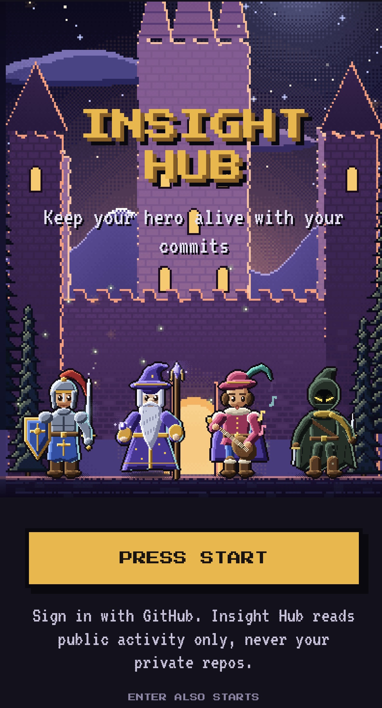
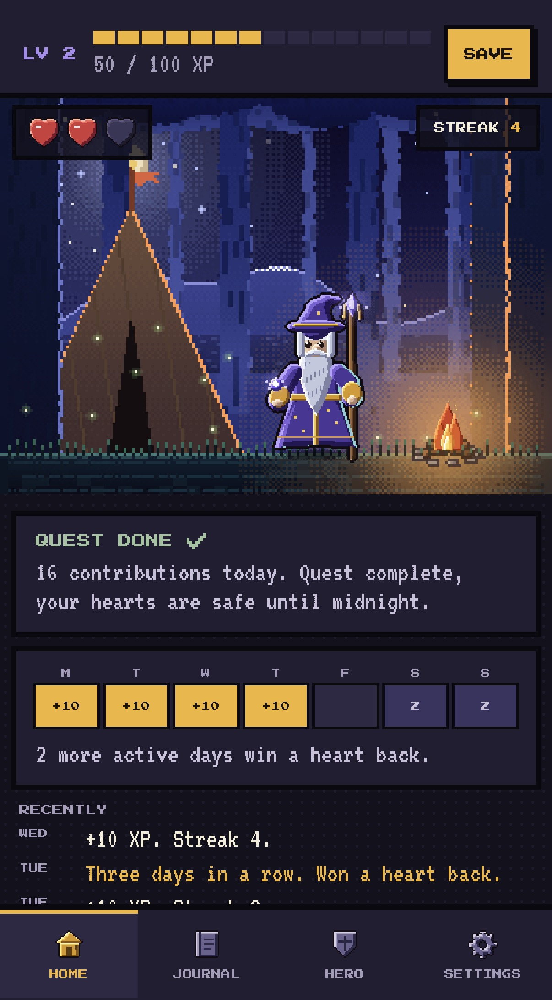
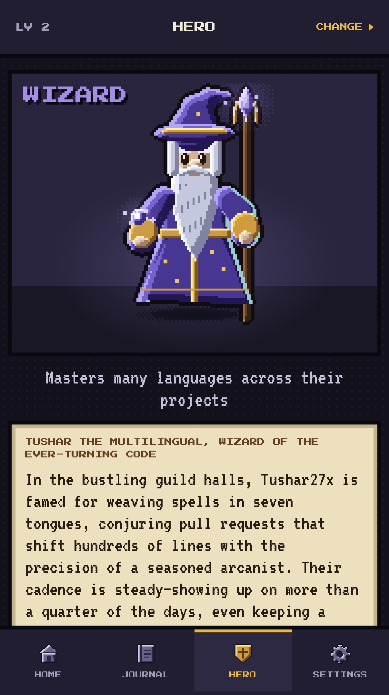
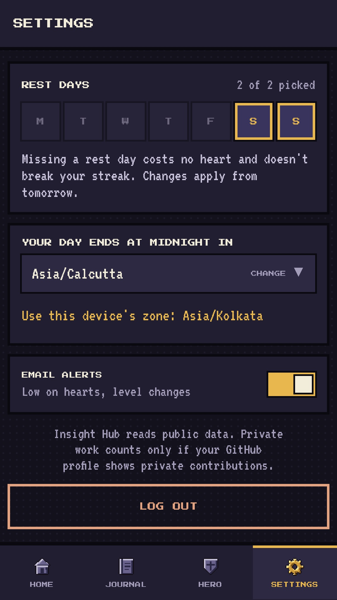
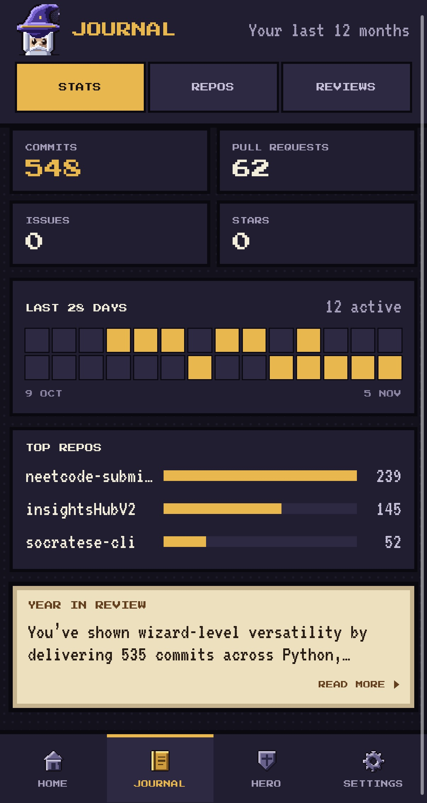
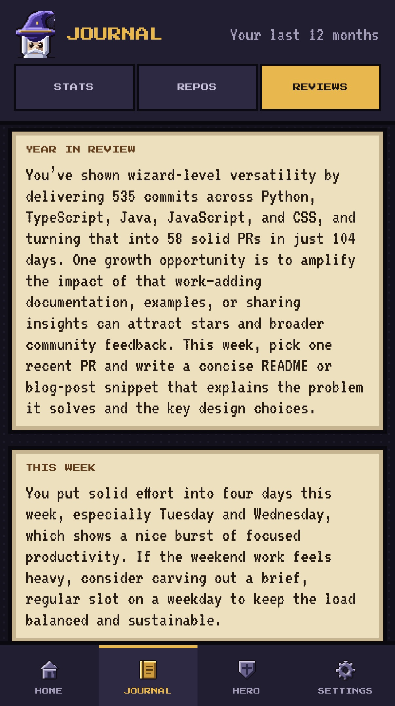

# Insight Hub

A GitHub habit tracker and activity dashboard. Sign in with GitHub and get a Tamagotchi-style
hero avatar that turns your commit habit into something you'd feel bad about neglecting: it loses
a heart for every day you go quiet, gains XP and levels up the days you don't, and its D&D class
is read off your real coding habits — alongside a journal of your commits, PRs, top repos and
AI-written reviews.

**Live app:** https://insights-hub-v2-one.vercel.app/


<p align="center">
  
  
  
  
</p>
<p align="center">
  
  
</p>

## What it does

- **Hero & hearts** — the hero avatar is a layer on top of the tracking, not the point of it: 3
  hearts, XP and levels. A day with GitHub activity (a commit, PR, issue — public activity only)
  feeds the hero; a day without one costs a heart. Pick weekly rest days that never cost a heart
  or break your streak.
- **Class from your habits** — an archetype classifier scores you 0–100 across 8 D&D classes
  (Wizard, Monk, Paladin, Artificer, Barbarian, Bard, Rogue, Cleric) from real signals: language
  spread, commit cadence, PR size, and more. Your class can change once it's clearly warranted.
- **Journal** — commits, PRs, issues, stars and a 28-day activity calendar; your top repos with an
  AI-written blurb for each; an AI year-in-review and a weekly review, each with a concrete
  suggestion, falling back to a static summary if the LLM call fails.
- **Settings** — rest days, timezone (defaults to your browser's), and email alerts for low hearts
  or a level change.
- **Email digest** — an optional daily summary email with an AI-written intro (off by default).

## How it's built

| | |
|---|---|
| **Backend** | Java 21 · Spring Boot 4 · Spring AI · virtual threads · Postgres (Neon) · Redis (Upstash) |
| **AI** | Groq (OpenAI-compatible), with a dormant Gemini fallback — every generator has a static fallback if the LLM is unavailable |
| **Auth** | GitHub OAuth2 + JWT; GitHub contribution data pulled via its GraphQL API |
| **Frontend** | Next.js 16 · React 19 · TypeScript · Tailwind 4 · TanStack Query |
| **Testing** | JUnit + Testcontainers (backend), Vitest (web), Playwright against mock/stubbed/full-stack backends (e2e) |
| **CI/CD** | GitHub Actions — backend, web and e2e on every PR; a Docker image built and pushed to Docker Hub on every merge to `main` |
| **Hosting** | Web on Vercel; backend as a Docker image on an AWS EC2 instance behind Caddy (HTTPS) |

```
browser ──▶ Vercel (web) ──/api/* rewrite──▶ EC2: Caddy ──▶ backend (Docker) ──▶ Neon / Redis / GitHub / Groq
```

## Running it locally

```bash
cd web
cp .env.example .env.local      # NEXT_PUBLIC_MOCK=1
npm install
npm run dev                     # http://localhost:3000 — the UI on fixture data, no backend needed
```

That's the web app alone, replaying a fixture story with no backend, database or API keys
required. For the full stack against real services (GitHub OAuth, Groq, Neon, Redis), see
[`docs/run-locally.md`](docs/run-locally.md).

## More docs

- [`docs/v2-hero-plan.md`](docs/v2-hero-plan.md) — the product spec and game rules
- [`docs/api/contract.md`](docs/api/contract.md) — the backend ⇄ web API contract
- [`docs/deploy.md`](docs/deploy.md) — how it's deployed
- [`AGENTS.md`](AGENTS.md) — repo layout and architecture notes
